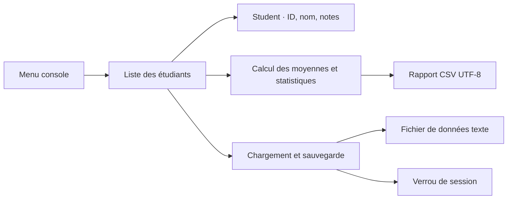

# Architecture de Student Management

## Problème et objectif

Dans une classe, tenir à jour une liste d’étudiants et recalculer les moyennes à la main prend du temps et peut produire des erreurs. Le projet fournit une application console permettant de retrouver un étudiant, de corriger ses notes, de conserver les données entre deux lancements et de produire un relevé exploitable dans un tableur.

## Conception

L’application est écrite en C++20 et compilée sous Windows avec Microsoft Visual Studio. Le diagramme UML initial a été modélisé avec PlantUML. Le schéma ci-dessous montre la version actuelle et ses fichiers de sortie.

## Format et stockage

Chaque enregistrement contient l’identifiant, le nom, le nombre de notes, puis une ligne par note. Par défaut, le programme utilise `students.txt`. L’option `--data` permet de choisir un autre fichier. Le chargement contrôle les doublons, les enregistrements incomplets et les notes invalides.

Une session verrouille son fichier de données. À chaque modification, le programme écrit un fichier temporaire dans le même dossier puis remplace l’original après une écriture réussie. Le rapport CSV est distinct et contient l’identifiant, le nom, le nombre de notes et la moyenne par étudiant.

## Références

- [Diagramme UML initial](diagramme.png) et [source PlantUML](diagramme.puml)
- [Compilation et tests](../README.md)

